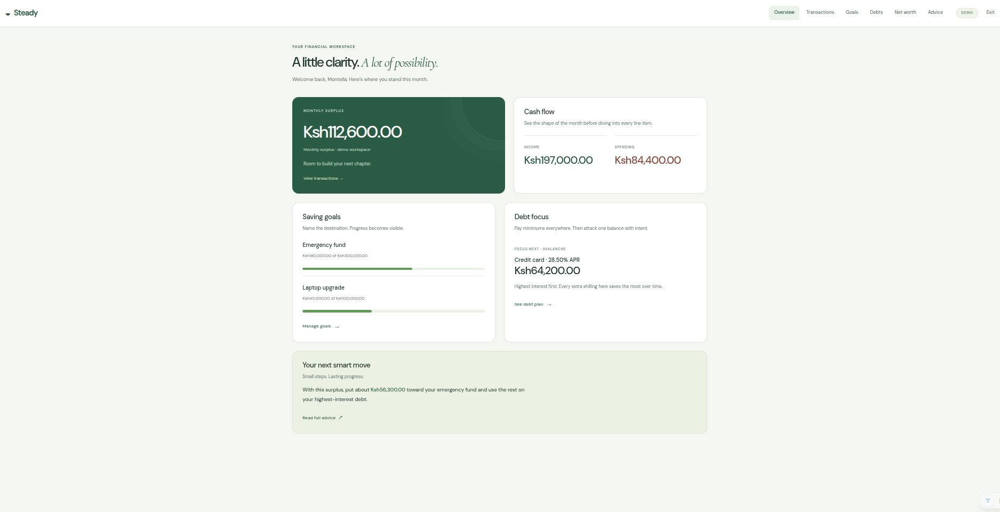
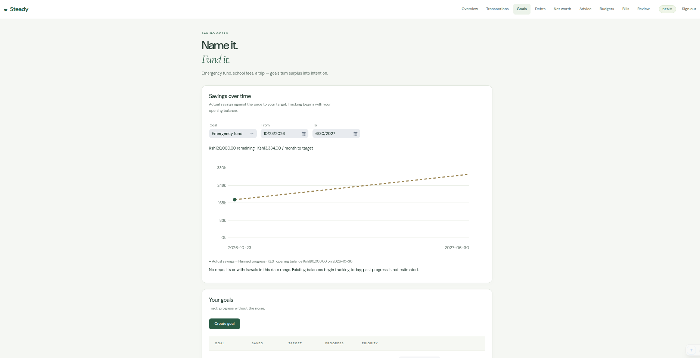
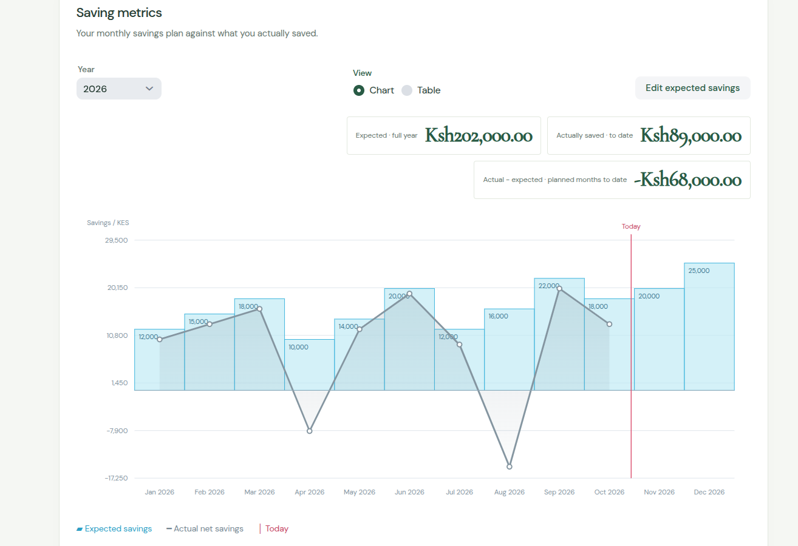

# Financial Literacy App

# This was created for a local use.... but ... you can contribute and we make it a real online app

Automated Personal Finance Tracker inspired by modern financial literacy principles.

**Stack:** Java 21 · Spring Boot 4 · Vaadin 25 · PostgreSQL

Want to help? See the [contribution guide](contribution.md) for development setup, testing, and pull request guidance.

## Features

- Persistent email/password accounts with salted PBKDF2 password hashes, login attempt limits, and workspace isolation.
- Separate demo workspaces: exploring sample data never resets a real account.
- Manual transactions, editable categories, accounts, and transfers excluded from income/spending totals.
- CSV import with validation, exact duplicate detection, and atomic imports (all valid rows or no changes).
- Monthly category budgets showing spending, remaining amounts, and near-limit/over-budget status.
- Savings goals with dated deposits and withdrawals, a movement ledger, and an actual-versus-planned savings graph.
- Goal/date-range selectors, remaining savings, and required monthly contributions.
- Bills and principal-only debt payments, monthly recurrence, due/overdue reminders, and dashboard reminders for the
  next seven days.
- Monthly cash-flow reviews, category breakdowns, savings movements, and debt balance comparisons from saved snapshots.
- CSV exports for reviews, transactions, goals/history, debts, net worth, bills, and budgets.
- Net worth tracking and Avalanche/Snowball debt guidance.

## Getting started

Create an account on the entry screen, then sign in again on future visits to keep using the same records. Names are
optional; email addresses are normalized. Passwords must be 12–128 characters. Five failed logins for an address
temporarily block attempts for 15 minutes (per application instance).

Use **Explore a separate demo** for sample data. Each demo is independent and does not modify any account. Demo
workspaces are not recoverable after sign-out; their database records currently remain until administrator cleanup.

## CSV transactions

Download the template from **Transactions → CSV template**, then choose a CSV file or paste its contents into **Import
CSV**. Required headers, in this order:

```csv
date,type,amount,category,merchant,description,account,destination
2026-01-15,EXPENSE,850.00,Food,Grocer,Weekly groceries,Bank,
2026-01-16,TRANSFER,2000.00,Savings,,Move to savings,Bank,Savings
```

Dates use `YYYY-MM-DD` and cannot be in the future. Amounts are positive with at most two decimal places. Types are
`INCOME`, `EXPENSE`, and `TRANSFER`; transfers require distinct source and destination accounts. Quoted commas, escaped
quotes, and multiline fields are supported. Imports accept up to 5,000 rows / 2 MB.

Exact matches use date, type, amount, category, merchant, description, and accounts. Reimported matches are skipped,
including matches against manual records. Review genuine identical payments manually. CSV text exports neutralize
spreadsheet formulas; they are records for review rather than an exact backup/restore format.

## Savings, bills, and reviews

Create a goal with an opening balance, then use **Deposit / withdraw** to record changes. Withdrawals cannot make
savings negative. The chart shows actual recorded balances and a linear planned path to the target date; it does not
invent historical progress. Existing balances start tracking from today. Savings movements track allocation to goals and
do not automatically create income or expenses.

Bills show in-app reminders; no email, push notification, or bank debit is sent. Recording payment creates an expense
dated today. A linked debt is reduced by the same amount, so link principal-only payments and record interest
separately. Monthly recurrence preserves the original day, clamping to the end of shorter months. Avoid importing or
manually entering the same payment again.

Use **Review → Save this month’s balance snapshot** to record current savings/debt balances. You can update the current
month's snapshot; prior snapshots remain unchanged. Debt comparisons require snapshots in consecutive months and reflect
net balance changes, including new borrowing and edits. No historical balances are estimated.

## Prerequisites

- Java 21+
- Maven 3.9+
- PostgreSQL database

## Database

The app expects a PostgreSQL database. Configuration is done via environment variables (or defaults in
`application.yml`):

```bash
export POSTGRES_HOST=localhost
export POSTGRES_PORT=5432
export POSTGRES_DB_NAME=
export POSTGRES_USER=
export POSTGRES_PASSWORD=your-database-password
export POSTGRES_SSLMODE=require   # or disable for local
```

## Running locally

```bash
mvn spring-boot:run
```

The Vaadin UI will open at http://localhost:8080

## Ubuntu executable and automatic startup, when running locally(vm..etc)

Build the standalone production JAR and install the local service:

```bash
mvn -Pproduction package
./scripts/install-local.sh
```

The installer copies the executable JAR to `~/.local/share/steady/steady.jar`, creates a private `~/.config/steady/steady.env` using the current database settings, and installs `steady.service` in your user systemd manager. Existing environment files are preserved on updates. Database credentials and the database itself are unchanged.

User lingering is enabled so the service starts during boot without requiring desktop login. The service waits **10 seconds** before launching Java; application/database startup takes a few additional seconds. If the database is not ready, systemd retries automatically. Java 21+ is required at runtime; Maven and frontend build tools are not needed at boot.

Open **Steady** in Ubuntu Applications, run `~/.local/bin/steady`, or visit **http://localhost:8808**. The app binds to this laptop only (`127.0.0.1`). The browser opens when you use the launcher; boot startup runs the server in the background.

```bash
systemctl --user status steady.service
systemctl --user restart steady.service
systemctl --user stop steady.service
journalctl --user -u steady.service -f
```

To install future code changes, repeat the build and installer commands. To disable automatic startup:

```bash
systemctl --user disable --now steady.service
```

The JAR can also be run directly with `java -jar target/financial-literacy-app-0.0.1-SNAPSHOT.jar --vaadin.launch-browser=false`. Stop the service first if using its port, and supply the same database environment settings. The installed service uses port `8808` and its private configuration file, so shell exports made after installation do not change it.

## Windows installation

With Java 21+ and a production build available, run this from **Git Bash** on Windows:

```bash
mvn -Pproduction package
bash scripts/install-widows.sh
```

The filename `install-widows.sh` is intentional. You can also run the installer directly from Windows PowerShell:

```powershell
powershell.exe -NoProfile -ExecutionPolicy Bypass -File .\scripts\install-windows.ps1
```

The installer uses the current `POSTGRES_*` environment variables, falling back to `application.yml`, and preserves existing configuration on updates. It stores the JAR, private `steady.json` configuration and logs in `%LOCALAPPDATA%\Steady`. No Python or administrator access is required. The `.sh` entry point requires Git Bash; it does not support WSL.

Steady starts in the background at **Windows sign-in** and binds to `127.0.0.1:8808`. Open **Steady** from the Start menu or visit http://localhost:8808. Check `stdout.log`, `stderr.log`, and `launcher.log` in the installation folder if startup fails. Server logs are replaced on each launch. Unlike the Linux service, this launcher does not automatically restart after a crash; use the Start menu shortcut to restart it.

Repeat the build and installation commands to update; the installer stops the existing managed instance before replacing the JAR. To stop it manually from PowerShell:

```powershell
New-Item -ItemType File -Force "$env:LOCALAPPDATA\Steady\stop"
```

To disable automatic startup, remove `Steady.lnk` from the folder opened by **Win+R → shell:startup**. Windows policy must permit PowerShell scripts for this installer and launcher to run.

## Project structure

```
src/main/java/com/financetracker/
├── model/          # JPA entities (Transaction, Debt, SavingGoal, NetWorthItem)
├── repository/     # Spring Data repositories
├── parser/         # Bank email parsers
├── service/        # Business logic + email polling + advice engine
├── config/         # Spring configuration
└── views/          # Vaadin UI views
```


## Tests

```bash
mvn test
```

Tests use an isolated H2 database in PostgreSQL compatibility mode and do not access your configured financial database.
They cover account persistence/password hashing, ownership checks, demo isolation, CSV parsing/import deduplication and
rollback, transfers, month boundaries, budgets, savings movements, recurring payments, and spreadsheet-safe export.

## Future integrations

Bank email parsing exists as a foundation; automatic account-aware IMAP polling is not wired up. CSV import and manual
entry are the available ingestion paths. Production database migrations, account recovery, and verified email delivery
remain follow-up work.







saving metrics


