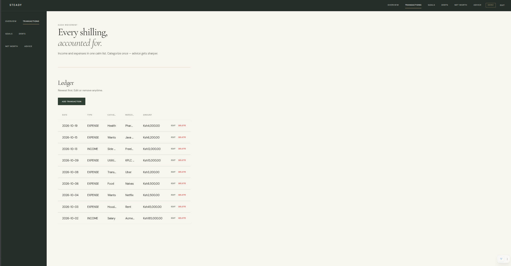

# Financial Literacy App

Automated Personal Finance Tracker inspired by modern financial literacy principles.

**Stack:** Java 21 · Spring Boot 4 · Vaadin 25 · PostgreSQL

## Features (planned / in progress)

- Automatically read bank notification emails (IMAP)
- Parse withdrawals / deposits and categorize them
- Track income vs expenses and monthly/yearly surplus
- Net worth tracker (assets – liabilities)
- Saving goals
- Debt management with Avalanche / Snowball advice
- 50/30/20 rule insights and actionable saving advice

## Prerequisites

- Java 21+
- Maven 3.9+
- PostgreSQL database

## Database

The app expects a PostgreSQL database. Configuration is done via environment variables (or defaults in `application.yml`):

```bash
export POSTGRES_HOST=localhost
export POSTGRES_PORT=5432
export POSTGRES_DB_NAME=
export POSTGRES_USER=
export POSTGRES_PASSWORD
export POSTGRES_SSLMODE=require   # or disable for local
```

## Running locally

```bash
./mvnw spring-boot:run
```

The Vaadin UI will open at http://localhost:8080

## Project structure

```
src/main/java/com/financetracker/
├── model/          # JPA entities (Transaction, Debt, SavingGoal, NetWorthItem)
├── repository/     # Spring Data repositories
├── parser/         # Bank email parsers
├── service/        # Business logic + email polling + advice engine
├── config/         # Spring configuration
└── views/          # Vaadin UI views
```

## Next steps

1. Configure your email IMAP credentials for automatic bank notification reading
2. Extend `BankEmailParser` with patterns specific to your banks
3. Build the Vaadin dashboard, transactions grid, goals, and advice views


